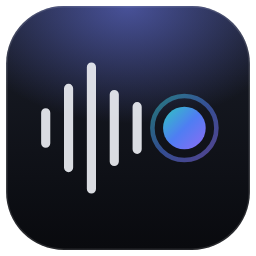
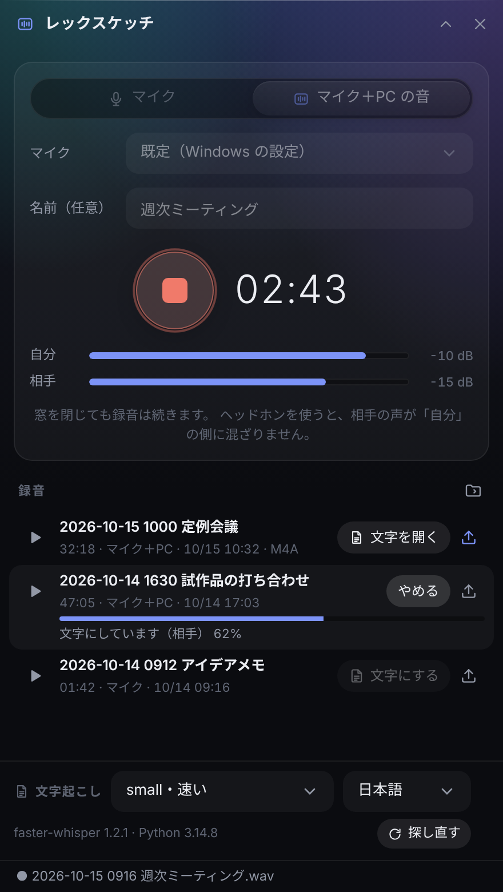
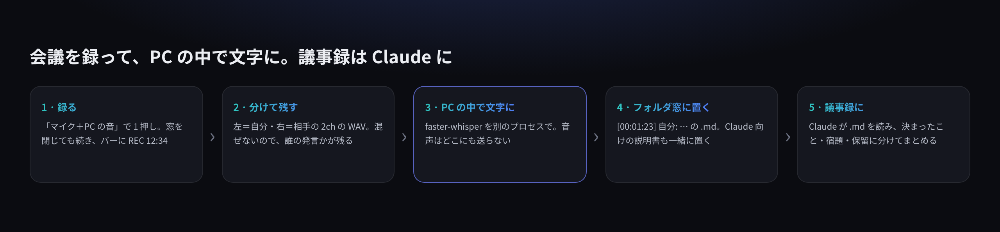
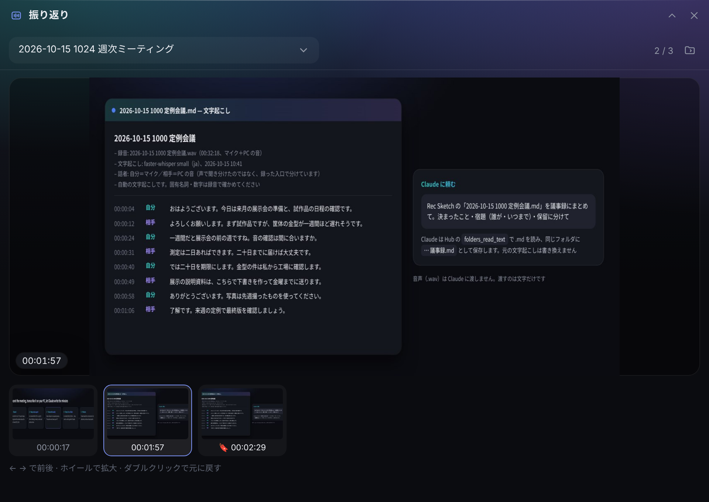
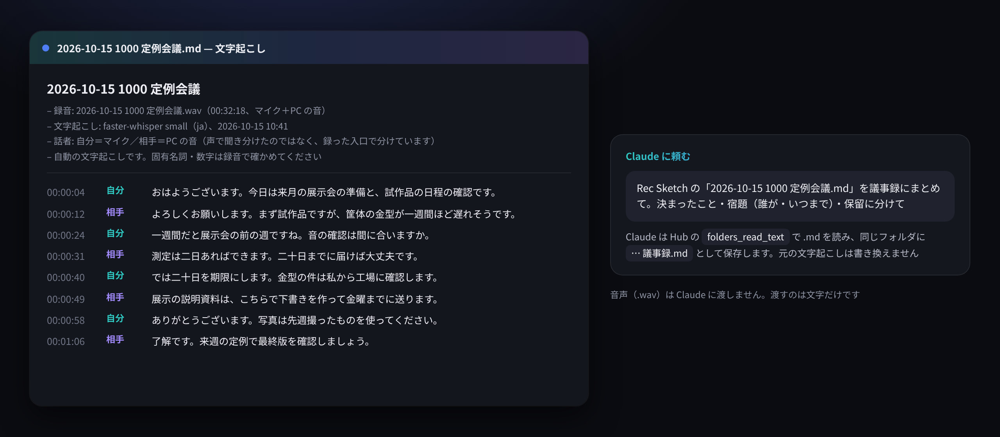

<p align="center"></p>

# Rec Sketch（レックスケッチ）

<p align="center"><a href="README.md">English</a> · <b>日本語</b></p>

Windows のデスクトップの端に置くバー **[Hub](https://github.com/satosugarforwork44x-lang/desktop-hub)** の拡張アプリです。
**マイクと PC の音（Web 会議の相手の声）を録って WAV に残し、PC の中で文字にします。**
文字は Hub のフォルダ窓に置かれるので、Claude に読ませて議事録にまとめてもらえます。音声はどこにも送りません。
人に送るときは、小さな **M4A** に書き出せます。
**「画面も」をオンにすると、画面の静止画も時刻つきで残ります**（スライドが替わったときは自動で、**F9 のしおり**を押したときはすぐに）。Claude は文字と静止画を合わせて読めます。

**ボイスメモとしても使えます。** 「マイク」を選んで録るだけで、思いついたことを声で残し、あとで文字にして読み返せます。



> ライセンス: [PolyForm Noncommercial 1.0.0](LICENSE) — 個人・営利目的でない利用は自由です。
> 画面の録音名・文字起こしは見本として作ったものです。

## 作った理由

会議のメモを取りながら話すのは難しく、あとで「誰が何をいつまでに」が分からなくなります。
録音アプリはたくさんありますが、困ったのは次の 3 つでした。

- **相手の声が録れない。** Web 会議の相手の声はスピーカーから出るので、マイクだけでは小さく、ヘッドホンだとまったく入らない
- **文字起こしはクラウドに音声を送るものが多い。** 社内の会議を外に出したくない
- **録って終わりになる。** 長い録音を聞き直すことはまずない。要るのは「決まったこと」と「宿題」

Rec Sketch は、Hub から 1 押しで録り始め、**自分の声と相手の声を別々に**残し、**PC の中で**文字にして、**Claude がそのまま読める場所**に置きます。





## UX で決めたこと

| 決めたこと | 理由 |
|---|---|
| **マイク＋PC の音は 2ch（左＝自分・右＝相手）で保存** | 混ぜると「誰が言ったか」が失われる。入口で分けておけば、文字起こしで「自分／相手」を付けられる |
| **録音は Hub の中の別スレッド。窓を閉じても止まらない** | 会議中にパネルを開きっぱなしにしなくてよい。バーに `REC 12:34` が出るので、録っていることは常に見える |
| **文字起こしは別のプロセス。faster-whisper の入った Python を自動で探す** | Hub と同じ Python に入らなくても使える（例: Hub は 3.15、文字起こしは 3.14）。大きなモデルのメモリが Hub に残らず、落ちても Hub は止まらない |
| **文字起こしは任意** | faster-whisper が無ければボタンを出さないだけで、録音はそのまま使える |
| **音声を Claude に送る道具は作らない** | 渡すのは文字（.md）だけ。Claude は Hub に今ある `folders_read_text` で読む |
| **スピーカーから回り込んだ相手の声は「自分」から外す** | ヘッドホンを使わないと、相手の声がマイクにも入る。同じ時刻・ほぼ同じ文なら重複として落とす |
| **騒音計は常に出さない** | マイクを開きっぱなしにしない。録音中の音量の確認だけに使う |
| **初回に「参加者の同意を」と出す** | 会議を録るときの約束を、最初に一度だけ確かめる |
| **画面は動画ではなく静止画** | 会議で要るのは「どの資料のときに何が決まったか」。動画は重く、圧縮の部品のライセンスも面倒になる。静止画なら軽く、Claude もそのまま読める |
| **自動の静止画は「広い範囲が変わって、止まったとき」だけ** | 共有の切り替え中・アニメーション・動画は止まらないので残らない。隅で動く顔の映像は「広い範囲」にならないので残らない。前のスライドに戻っても、同じ画面は二度残さない |
| **しおりは F9 の 1 キー**（設定で替えられる） | とっさに押すには、組み合わせのキーは多すぎる。どの窓を見ていても効くように Windows 全体に登録するが、**録音中だけ**登録して、止めたら外す |
| **振り返りは別の窓** | 会議の画面を見ながら、前に共有された資料を見返したい。パネルの中では小さすぎるので、Hub の別窓（位置と大きさを覚える）にした。もう 1 枚の画面に置いておける |
| **録音中は Hub の窓を写さない**（Hub 0.10 以上） | 会議と同じ画面で Hub を操作しても、振り返り窓やパネルが静止画に写り込まない。Hub 0.9 では代わりに、振り返り窓を開いている間だけ自動の静止画を止める |
| **しおりは画面のボタンでも付けられる** | キーだけの機能は気づかれない。録音中は「しおり（F9）」のボタンと、静止画・しおりの数を出す |
| **画面を取るのは「画面も」をオンにした録音中だけ** | 画面には通知やチャットも映る。初回に注意を出し、取るモニターも選ぶ |
| **録音は WAV、送るときだけ M4A** | WAV は少しずつ書けて途中で落ちても聞け、文字起こしにもそのまま使える。ただし 1 時間の会議（2ch）で約 690MB と大きいので、送るときは M4A（AAC 64kbps・モノラル）にする。約 30MB になり、Windows・iPhone・Android・Mac のどれでも再生できる |
| **送る M4A は 1 本（モノラル）に混ぜる** | 左右に分かれた音は、受け取った人には聞きにくい。分けるのは文字起こしのためなので、送る音には要らない |
| **上書きしない** | 同じ名前があれば `name (2).wav`。少しずつ書くので、途中で Hub が落ちてもそこまでは聞ける |

## 機能

| 機能 | 内容 |
|---|---|
| 録音 | マイクだけ（1ch）／マイク＋PC の音（2ch）。48 kHz・16 bit の WAV。マイクは一覧から選べる |
| 音量 | 録音中だけ、自分・相手の音量を棒で表示 |
| 画面も | 選んだモニターの静止画を、広く変わって止まったとき自動で（JPEG）。最短 10 秒あける |
| 振り返り | 録音中の「振り返り」か一覧の 🖼 で別窓を開く。大きな画像と時刻つきの小さな画像の帯、← →、ホイールで拡大。録音中は「最新に追従」 |
| しおり | F9（またはボタン）でその瞬間を PNG で残し、文字起こしに 🔖 を付ける。「画面も」がオフなら印だけ |
| ボイスメモ | 「マイク」だけで録る。名前を空にすれば `<日時> 録音.wav`。会議と同じように文字にできる |
| 一覧 | 聞く・文字にする・文字を開く・共有用に書き出す。エクスプローラーで保存先を表示 |
| 共有用に書き出す | 各行の ↑ ボタンで `<名前>.m4a`（AAC 64kbps・モノラル、1 分あたり約 0.5MB）。できたらエクスプローラーで見せる。PyAV が無ければボタンを出さない |
| 文字起こし | faster-whisper（small / medium / large-v3-turbo）、日本語・英語・自動。時刻と「自分／相手」付きの `.md`（英語で起こすと `Me` / `Them`） |
| バー | 録音中は `REC 12:34`、文字起こし中は `TXT 42%` |

### 使い方の例

| 場面 | 使い方 |
|---|---|
| Web 会議の議事録 | 「マイク＋PC の音」で録る → 文字にする → Claude に「議事録にまとめて」 |
| ボイスメモ | 「マイク」で録る → 必要なら文字にする。アイデア・買い物・あとでやること |
| 画面を使う会議・説明 | 「画面も」をオン → 大事な所で F9 → 文字にする → Claude に「しおりの所を中心にまとめて」 |
| 会議中に前の資料を見返す | 「振り返り」で別窓を開き、もう 1 枚の画面（か同じ画面の端）に置く。新しいスライドは自動で追加される |
| 録音を人に送る | ↑ で M4A に書き出す → エクスプローラーに出たファイルをメールやチャットに貼る |

## 入れ方

1. このリポジトリを Hub のモジュールのフォルダに `rec` という名前で置く
   - 利用者が足すモジュール: `%LOCALAPPDATA%\Hub\modules\rec\`（Hub を更新しても消えない）
2. 録音に必要なものを入れる（どちらも BSD-3-Clause）
   ```bat
   py -m pip install soundcard numpy
   ```
3. 文字起こしもするなら（任意・MIT）
   ```bat
   py -m pip install faster-whisper
   ```
   Hub と別の版の Python に入れてもかまいません（例: `py -3.14 -m pip install faster-whisper`）。Rec Sketch が `py -0p` で探します
4. 画面も残すなら（任意）: `py -m pip install mss pillow`（mss は MIT、Pillow は HPND）
5. 共有用の M4A を作るのに使う **PyAV** は、faster-whisper と一緒に入ります。文字起こしをしない場合は `py -m pip install av` だけでも使えます
6. Hub を再起動 → バーに「レックスケッチ」が出る

対応: Windows 10/11、Python 3.10 以上、Hub 0.9 以上。

## 保存先

フォルダ窓の置き場所の下に **`Rec Sketch`** フォルダができます（設定 `modules.rec.folder` で変えられます）。

| ファイル | 中身 |
|---|---|
| `<日時> <名前>.wav` | 録音 |
| `<日時> <名前>.md` | 文字起こし（`[00:01:23] 自分: …`） |
| `<日時> <名前>.m4a` | 共有用に書き出したもの（モノラル） |
| `<日時> <名前>/` | 「画面も」の静止画（`t001230-auto.jpg` 自動、`t001230-mark.png` しおり）と `shots.json`。文字起こしの `.md` に時刻の順で入る |
| `REC_FORMAT.md` | Claude 向けの説明（自動で置かれる） |

### Claude に議事録を頼む
Hub の 設定 → Claude 連携 で、フォルダ窓「Rec Sketch」を「読む」（議事録を書かせるなら「読み書き」）にして、
「Rec Sketch の 〇〇.md を議事録にまとめて」と頼みます。



## 文字起こしの目安

モデルは初回だけネットから取得します（small 約 0.5GB / medium 約 1.5GB / large-v3-turbo 約 1.6GB）。以後は PC の中だけで動きます。
CPU だけで動かすので、長い会議は small から試してください。

## 注意

- 録音が「録音が止まりました」で止まるときは、Windows の 設定 → プライバシーとセキュリティ → マイク で、マイクへのアクセスと「デスクトップ アプリがマイクにアクセスできるようにする」が オン か確かめてください
- 会議を録るときは、参加者に伝えて同意をもらってください
- 「画面も」で録っている間（Hub 0.10 以上）は、Hub の窓がほかのアプリの画面共有・スクリーンショットにも写りません。会議で Hub を見せたいときは「画面も」をオフにしてください
- 「画面も」の静止画には、画面に映っている物がそのまま残ります（通知・チャット・ほかの人の顔・パスワードなど）。人に送る前に中身を確かめてください
- 自動の文字起こしです。固有名詞・数字は録音で確かめてください
- 「自分／相手」は声の聞き分けではなく、録った入口で分けています。相手が複数いても全員「相手」です

## ファイル

| ファイル | 内容 |
|---|---|
| `api.py` | 保存先・一覧・録音の開始と停止・文字起こしの起動・バーの表示 |
| `recorder.py` | 録音（soundcard。別スレッドで少しずつ WAV に書く） |
| `transcribe.py` | 文字起こし（別プロセスで動く。faster-whisper） |
| `share.py` | 共有用の M4A に書き出す（別プロセスで動く。PyAV） |
| `screen.py` | 画面の静止画（mss で取り、Pillow で比べる。自動としおり） |
| `hotkey.py` | どの窓でも効くキー（Windows の RegisterHotKey。録音中だけ） |
| `tools/check_video.py` | この PC で画面・動画の部品が使えるかを調べる |
| `ui/panel.js` `ui/viewer.js` `ui/rec.css` | 画面（パネル・振り返り窓） |
| `REC_FORMAT.md` | 保存先に置く Claude 向けの説明 |
| `tests/test_rec.py` | `py -m unittest discover -s tests` |

## ライセンス

| もの | ライセンス |
|---|---|
| Rec Sketch | PolyForm Noncommercial 1.0.0 |
| soundcard | BSD-3-Clause |
| numpy | BSD-3-Clause |
| faster-whisper / CTranslate2 / Whisper のモデル | MIT |
| mss | MIT |
| Pillow | HPND（MIT に近い、自由に使える） |
| PyAV | BSD-3-Clause。配布されているホイールには FFmpeg（LGPL）と、版によっては x264・x265 などの GPL のライブラリも入っています。Rec Sketch は PyAV を同梱せず、その中の FFmpeg 自身の AAC 圧縮だけを使います |
