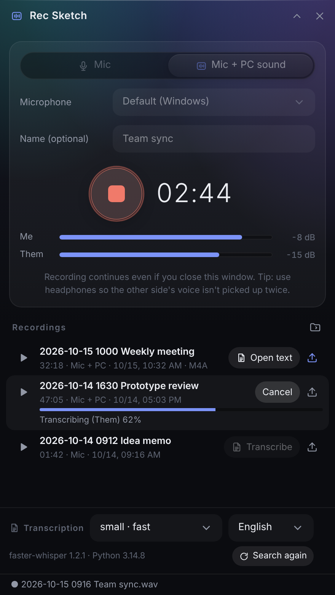
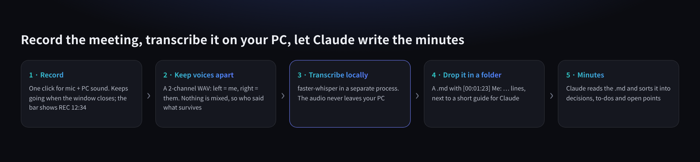
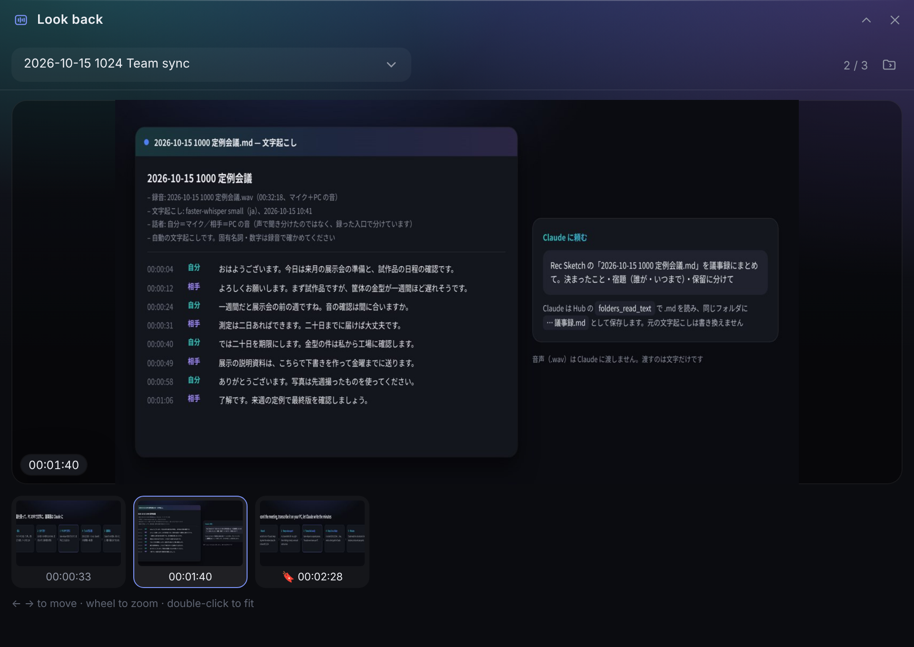
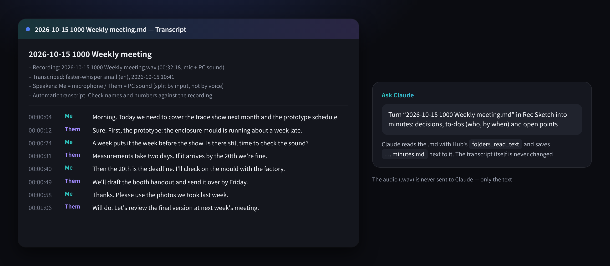

<p align="center"></p>

# Rec Sketch

<p align="center"><b>English</b> · <a href="README.ja.md">日本語</a></p>

An extension app for **[Hub](https://github.com/satosugarforwork44x-lang/desktop-hub)**, the slim bar on the edge of your Windows desktop.
**Record your microphone and your PC's sound (the other side of a web meeting) to WAV, and transcribe it on your own PC.**
The text lands in a Hub folder panel, so Claude can read it and write the minutes. The audio never leaves your PC.
When you want to send a recording to someone, export a small **M4A**.
**Turn on "Screen" to keep timestamped stills of your display too** — automatically when the slide changes, and at once when you press **F9** to bookmark. Claude reads the text and the stills together.

**It works as a voice memo too.** Choose "Mic", record a thought, and transcribe it later if you like.



> License: [PolyForm Noncommercial 1.0.0](LICENSE) — free for personal and other non-commercial use.
> The recording names and transcripts shown are made-up samples.

## Why I built this

Taking notes while talking in a meeting is hard, and afterwards nobody remembers who agreed to do what by when.
There are plenty of recorder apps, but three things kept getting in the way:

- **The other side isn't recorded.** In a web meeting their voice comes out of the speakers: faint on the mic, and missing entirely with headphones.
- **Most transcription sends your audio to the cloud.** Not something you want for internal meetings.
- **Recordings just pile up.** Nobody re-listens to an hour of audio. What you need is the decisions and the to-dos.

Rec Sketch starts recording with one click from Hub, keeps **your voice and the other side's voice apart**, transcribes **on your PC**,
and puts the text **where Claude can read it**.





## UX decisions

| Decision | Why |
|---|---|
| **Mic + PC sound is saved as 2 channels (left = you, right = PC)** | Mixing loses who said what. Splitting at the source lets the transcript label every line Me or Them (自分 / 相手 in Japanese) |
| **Recording runs in a background thread inside Hub** | Close the window and it keeps going. The bar shows `REC 12:34`, so you always know it's on |
| **Transcription runs as a separate process, using whichever Python has faster-whisper** | Works even when faster-whisper can't be installed into Hub's Python (e.g. Hub on 3.15, transcription on 3.14). The big model never stays in Hub's memory, and a crash can't take Hub down |
| **Transcription is optional** | Without faster-whisper the button simply isn't shown; recording works as usual |
| **No tool sends audio to Claude** | Only the text (.md) is shared. Claude reads it with Hub's existing `folders_read_text` |
| **Their voice leaking into your mic is removed from Me** | Without headphones the mic hears the speakers too. Lines at the same time with nearly the same words are dropped as echoes |
| **No always-on noise meter** | The mic is only open while recording; the level bars are just for checking the input |
| **A one-time consent reminder** | Recording a meeting needs everyone's consent; the panel says so once |
| **Stills, not video** | What a meeting needs is "which slide was up when we decided that". Video is heavy and brings encoder licensing headaches; stills are light and Claude can read them directly |
| **Auto stills only when a large area changes and then settles** | Switching shares, animations and videos never settle, so they're skipped. A face moving in a corner isn't "a large area". Going back to a slide doesn't save it twice |
| **Bookmark is a single key, F9** (changeable) | Key combos are too much to hit on the spot. It works from any window because it's registered with Windows — **only while recording**, and released when you stop |
| **Look back in a separate window** | During a meeting you want the current screen and an earlier slide side by side. The panel is too small, so it's a Hub window of its own (position and size are remembered) that you can park on another display |
| **Hub's windows stay out of the stills** (Hub 0.10+) | Using Hub on the same screen as the meeting doesn't put the look-back window or panels into the stills. On Hub 0.9, automatic stills pause while the look-back window is open instead |
| **Bookmarks have a button too** | Features that only exist as shortcuts are never found. While recording the panel shows "Bookmark (F9)" and the number of stills and bookmarks |
| **The screen is only captured while recording with "Screen" on** | Notifications and chats show up on screen. You get a one-time warning and choose which display to capture |
| **Record in WAV, share in M4A** | WAV is written as it goes (a crash still leaves a playable file) and feeds transcription directly. But an hour of 2-channel audio is about 690 MB, so sharing uses M4A (AAC 64 kbps, mono): about 30 MB, and it plays on Windows, iPhone, Android and Mac |
| **The shared M4A is mixed down to mono** | Left/right split voices are awkward to listen to. The split only exists for the transcript |
| **Nothing is overwritten** | `name (2).wav`. The file is written as it goes, so a crash still leaves everything up to that point |

## Features

| Feature | What it does |
|---|---|
| Record | Mic only (1 ch) or mic + PC sound (2 ch). 48 kHz / 16-bit WAV. Pick the microphone from a list |
| Levels | Live level bars for you and the PC sound while recording |
| Screen | Stills of the chosen display when a large area changes and settles (JPEG), at least 10 s apart |
| Look back | "Look back" while recording, or 🖼 on a row, opens a separate window: a large image, a strip of timestamped thumbnails, ← →, wheel zoom. While recording it follows the latest still |
| Bookmark | F9 (or the button) keeps that moment as PNG and marks 🔖 in the transcript. With "Screen" off it's just the mark |
| Voice memo | Record with "Mic" only. Leave the name empty for `<date> 録音.wav`. Transcribe it just like a meeting |
| List | Play, transcribe, open the text, export to share, show the folder in Explorer |
| Export to share | The ↑ button on each row makes `<name>.m4a` (AAC 64 kbps, mono, about 0.5 MB per minute) and shows it in Explorer. Hidden if PyAV isn't installed |
| Transcribe | faster-whisper (small / medium / large-v3-turbo), Japanese / English / auto. A `.md` with timestamps and Me / Them labels |
| Bar | `REC 12:34` while recording, `TXT 42%` while transcribing |

### Ways to use it

| When | How |
|---|---|
| Minutes of a web meeting | Record "Mic + PC sound" → Transcribe → ask Claude for the minutes |
| Voice memo | Record "Mic" → transcribe if you need text. Ideas, shopping lists, things to do later |
| Meetings with slides, walkthroughs | Turn on "Screen" → press F9 at the key moments → Transcribe → ask Claude to "focus on the bookmarks" |
| Re-reading an earlier slide mid-meeting | Open "Look back" and park it on another display (or the edge of the same one). New slides are added as they appear |
| Sending a recording | ↑ to export M4A → drag the file Explorer shows into an email or chat |

## Install

1. Put this repository into Hub's module folder as `rec`: `%LOCALAPPDATA%\Hub\modules\rec\`
2. Install what recording needs (both BSD-3-Clause):
   ```bat
   py -m pip install soundcard numpy
   ```
3. Optional, for transcription (MIT):
   ```bat
   py -m pip install faster-whisper
   ```
   It may go into a different Python than Hub's (e.g. `py -3.14 -m pip install faster-whisper`); Rec Sketch looks for it with `py -0p`.
4. Optional, to keep the screen: `py -m pip install mss pillow` (mss is MIT, Pillow is HPND)
5. **PyAV**, used to export M4A, comes with faster-whisper. Without transcription, `py -m pip install av` is enough.
6. Restart Hub — "Rec Sketch" appears on the bar.

Requires Windows 10/11, Python 3.10+, Hub 0.9+.

## Where files go

A **`Rec Sketch`** folder is created next to your other folder panels (change it with `modules.rec.folder`).

| File | Contents |
|---|---|
| `<date> <name>.wav` | The recording |
| `<date> <name>.md` | The transcript (`[00:01:23] Me: …`) |
| `<date> <name>.m4a` | The exported copy for sharing (mono) |
| `<date> <name>/` | Screen stills (`t001230-auto.jpg` automatic, `t001230-mark.png` bookmark) and `shots.json`; they appear in the transcript in time order |
| `REC_FORMAT.md` | A short guide for Claude (placed automatically) |

To get minutes: in Hub's Settings → Claude, share the "Rec Sketch" folder panel, then ask Claude to "summarise <name>.md as minutes".



The model is downloaded once on first use (small ≈ 0.5 GB, medium ≈ 1.5 GB, large-v3-turbo ≈ 1.6 GB); after that everything runs offline on the CPU.

## Notes

- If recording stops right away, check Windows Settings → Privacy & security → Microphone: microphone access and "Let desktop apps access your microphone" must be on.
- Tell everyone you are recording and get their consent.
- While recording with "Screen" on (Hub 0.10+), Hub's windows don't show up in other apps' screen sharing or screenshots either. To show Hub in a meeting, record with "Screen" off.
- Screen stills keep whatever was on the display (notifications, chats, other people's faces, passwords). Check them before sending them to anyone.
- Automatic transcripts get names and numbers wrong sometimes — check against the audio.
- Me / Them comes from where the sound was recorded, not from voice recognition. Everyone on the other side is Them.
- Transcribing in English gives English headings and `Me` / `Them` labels.

## License

| Component | License |
|---|---|
| Rec Sketch | PolyForm Noncommercial 1.0.0 |
| soundcard, numpy | BSD-3-Clause |
| faster-whisper, CTranslate2, Whisper models | MIT |
| mss | MIT |
| Pillow | HPND (permissive, MIT-like) |
| PyAV | BSD-3-Clause. Its wheels bundle FFmpeg (LGPL) and, depending on the build, GPL libraries such as x264 / x265. Rec Sketch doesn't ship PyAV and only uses FFmpeg's own AAC encoder from it |
